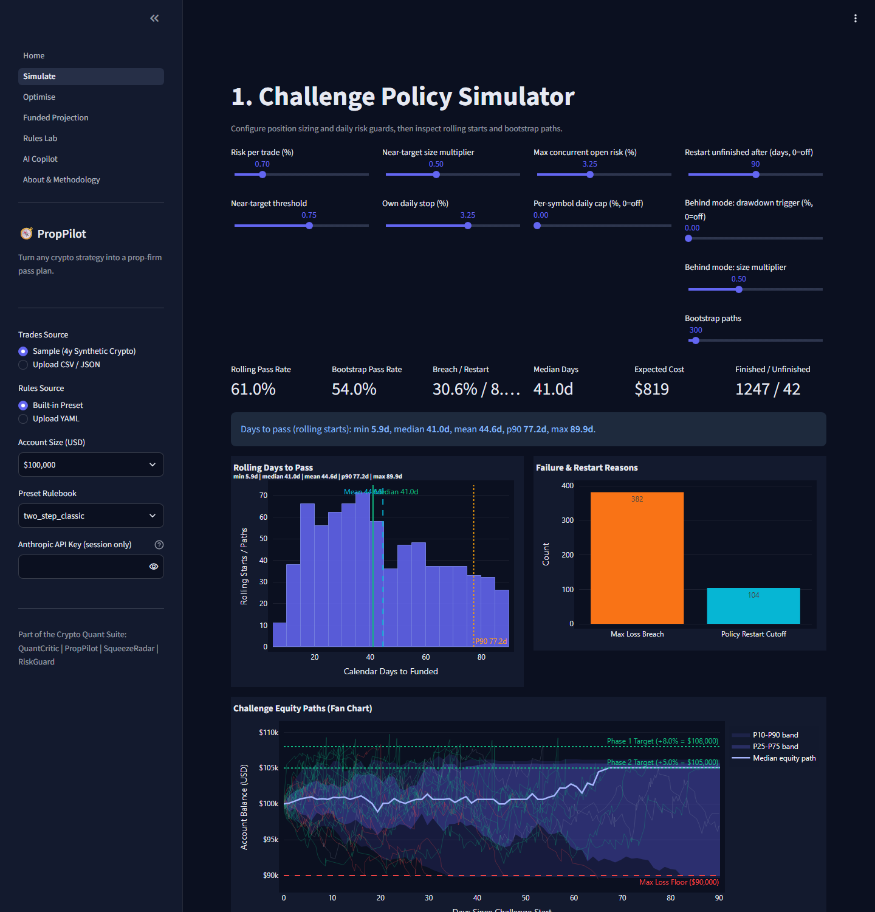
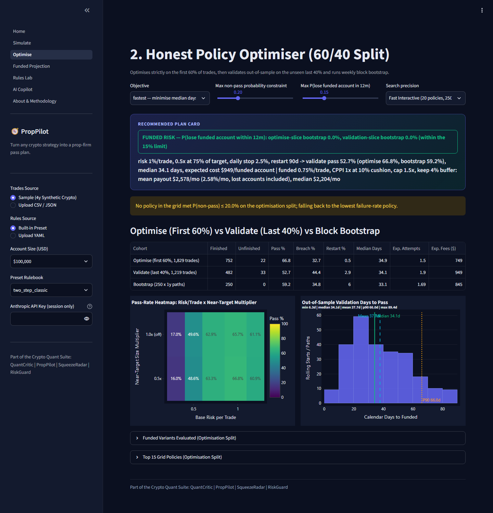
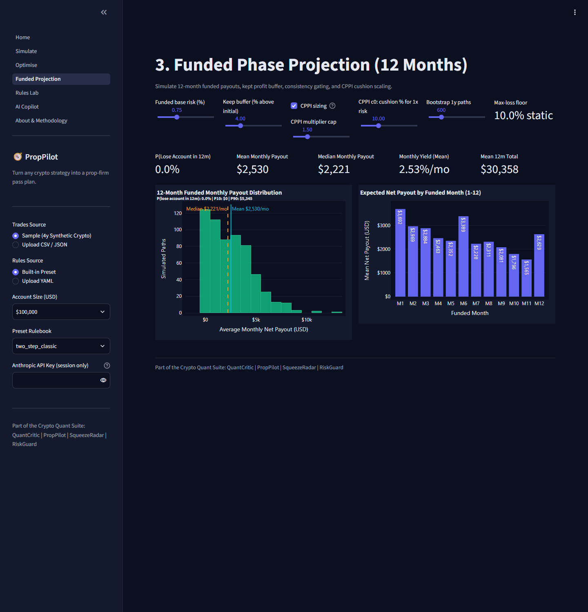
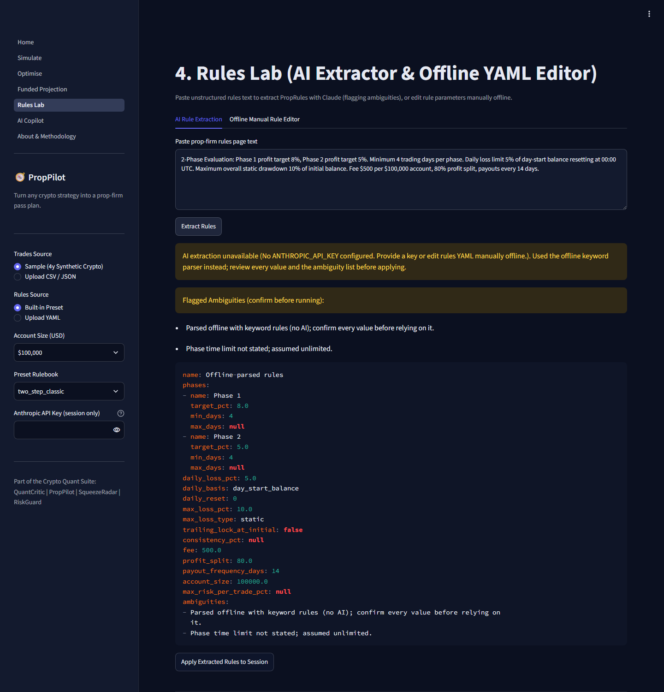
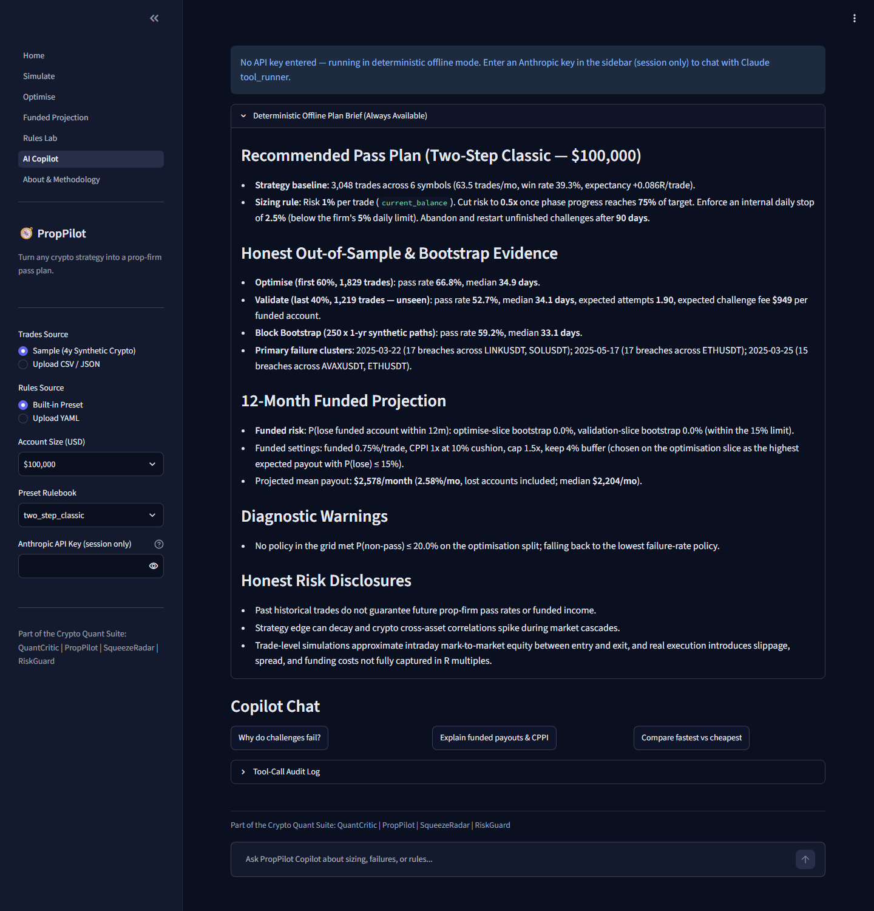
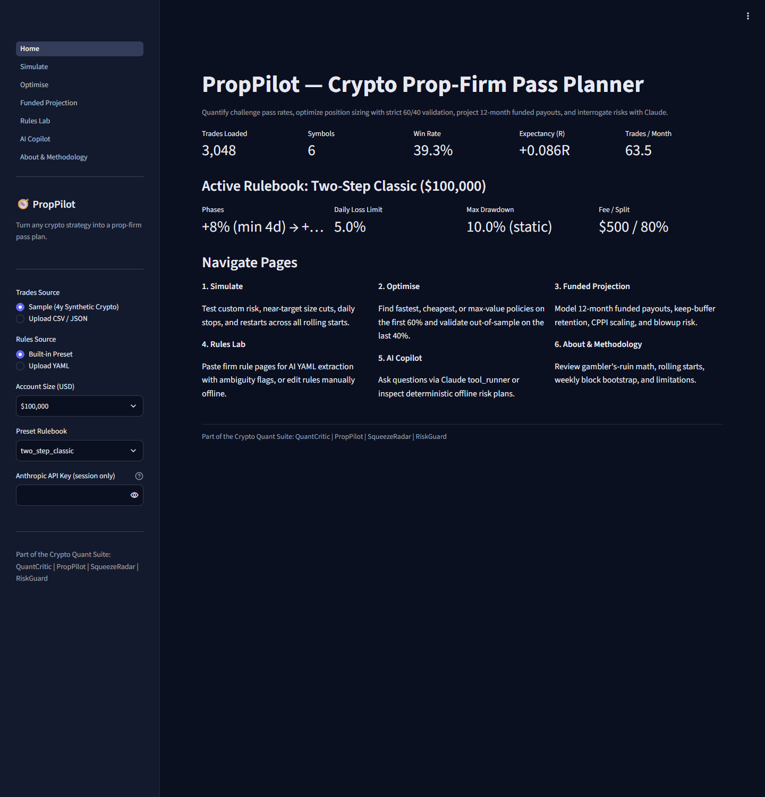
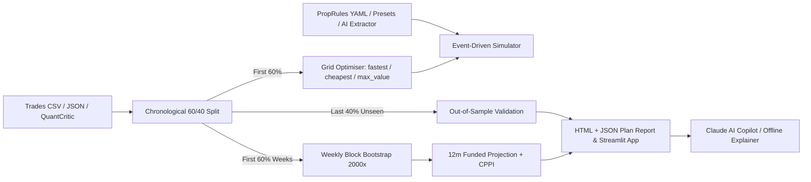

# PropPilot

**Turn any crypto strategy into a prop-firm pass plan.**

PropPilot is an open-source quantitative position-sizing simulator, honest 60/40 policy optimiser, 12-month funded payout projector, and Claude AI risk copilot for crypto prop-trading evaluations.

---

## Screenshots

Real screenshots of the running app (headless Chromium, default settings, no API key).


<sub>Simulate: pass rate, fail reasons, days-to-pass, equity fan</sub>

| | |
|---|---|
| <br><sub>Optimise: plan chosen on 60 % of trades, validated on the unseen 40 %</sub> | <br><sub>Funded projection: payouts and the effect of CPPI protection</sub> |
| <br><sub>Rules Lab: plain-text rules -> structured limits + ambiguities</sub> | <br><sub>AI Copilot (offline mode shown)</sub> |
| <br><sub>Home</sub> |  |

---

## The Problem: Why Edge Alone Still Fails Challenges

Most crypto traders fail prop-firm evaluations not because their strategy lacks positive expectancy, but because **position sizing ignores the rules' asymmetric absorbing barriers**:

- **Gambler's Ruin Near Drawdown Limits**: Constant aggressive risk turns normal volatility into a permanent daily-loss or max-loss breach.
- **Correlated Same-Day Crypto Cascades**: Simultaneous trades across BTC, ETH, SOL, and altcoins often lose together during liquidation spikes—breaching a 5% daily limit in hours.
- **No Near-Target Protection**: Taking full risk at +7% toward an +8% target adds variance without upside beyond the capped phase goal.
- **Optimiser Overfitting**: Picking sizing parameters on an entire backtest cherry-picks the historical regime and understates expected fees.

PropPilot models every rule event-by-event across all rolling calendar-day starts and weekly block-bootstrap paths, optimises strictly on the first 60% of trades, validates out-of-sample on the unseen last 40%, and projects 12-month funded payouts with CPPI sizing. A funded plan is only recommended if its probability of losing the funded account within 12 months stays below a configurable limit (default 15%), and that probability is printed on every plan card.

---

## How It Works



---

## Quickstart

### 1. Install
Requires Python 3.11–3.13 (Windows & Linux). No numba, no parquet, no network downloads required.

```bash
pip install -r requirements.txt
```

### 2. Run the Full Offline Demo
Generates complete pass plans on the included **SYNTHETIC** sample dataset (`examples/trades_sample.csv`) under the `two_step_classic` and `one_step` presets (objective `fastest`, `max_fail` 0.40, funded P(lose) limit 15%) and writes single-file HTML (Plotly.js is loaded from its CDN) + JSON reports to `reports/` (`demo_plan.*`, `demo_plan_one_step.*`):

```bash
python -m proppilot demo
```

### 3. Launch the Streamlit Web App
```bash
streamlit run streamlit_app.py
```

The multipage dashboard includes:
1. **Simulate** — interactive sliders for risk, near-target cuts, behind mode, daily stops, open-risk and per-symbol caps, restarts, days-to-pass histogram, and equity fan chart
2. **Optimise** — `fastest` / `cheapest` / `max_value` search with `max_fail` and funded `P(lose)` limit sliders, 60/40 comparison table, `risk_pct x near_mult` heatmap, evaluated funded variants, and a Plan Card with the funded-account risk banner
3. **Funded Projection** — 12-month payout distribution, `P(lose account)`, funded risk, keep-buffer, and CPPI controls
4. **Rules Lab** — paste firm rules text for extraction (Claude with an explicit ambiguity list, or the offline keyword parser without a key) or edit rules in an offline form / YAML editor (including `trailing_lock_at_initial`)
5. **AI Copilot** — Claude `tool_runner` risk analyst + tool-call log + deterministic offline plan brief without an API key
6. **About & Methodology** — formulas, assumptions, and Crypto Quant Suite overview

---

## CLI Reference

```bash
# Simulate a single policy across rolling starts, bootstrap, and funded projection
python -m proppilot simulate --trades examples/trades_sample.csv --rules two_step_classic

# Optimise on first 60% and validate on unseen last 40% (funded P(lose) limit 15% by default)
python -m proppilot optimize --trades examples/trades_sample.csv --rules one_step --objective fastest --max-fail 0.2 --max-lose-funded 0.15

# Generate HTML + JSON report (add --ai when ANTHROPIC_API_KEY is set)
python -m proppilot plan --trades examples/trades_sample.csv --rules two_step_classic --objective max_value --out-dir reports

# Extract PropRules YAML from unstructured text (Claude if a key is set, else the offline keyword parser;
# both list ambiguities for review)
python -m proppilot rules --from examples/rules_sample.txt --out custom_rules.yaml

# Interactive AI / offline Copilot terminal session
python -m proppilot chat --trades examples/trades_sample.csv --rules two_step_classic
```

---

## Included Generic Presets

All presets in `proppilot/presets/` use generic, non-branded rulebooks:

- **`two_step_classic.yaml`**: +8% Phase 1, +5% Phase 2, 5% daily loss (day-start balance, 00:00 UTC reset), 10% static max loss, min 4 trading days per phase, unlimited duration, $500 fee per $100k, 80% split, 14-day payouts.
- **`one_step.yaml`**: +10% Evaluation, 3% daily loss, 6% trailing closed-balance high-water mark (`trailing_lock_at_initial: false`, i.e. the floor keeps trailing), min 3 trading days, $500 fee per $100k, 80% split.
- **`instant.yaml`**: No evaluation phases, 3% daily loss, 6% trailing closed-balance high-water mark (`trailing_lock_at_initial: false`), 15% consistency cap (best day $\le 15\%$ of cycle profit before payout).

`trailing_lock_at_initial` is an explicit rules field: set it to `true` for firms whose trailing drawdown stops rising once it reaches the starting balance. Both the challenge and funded simulators read it.

---

## Input Format & QuantCritic Compatibility

Trades CSV/JSON files require UTC columns:
- `entry_time`, `exit_time` (UTC timestamps)
- `symbol` (e.g., `BTCUSDT`, `ETHUSDT`)
- `R` (net result in units of initial risk; e.g., `-1.0` = full stop, `2.1` = winner)
- Optional: `side` (any extra columns from **QuantCritic** exports are automatically accepted and ignored)

> **Note on `examples/trades_sample.csv`**: The bundled 4-year, 6-symbol sample dataset is **100% SYNTHETIC**, deterministically generated by `proppilot/synthetic.py` (seed `42`, `python -m proppilot.synthetic`). It is calibrated to look like a decent but ordinary crypto system, not a money printer: 3,048 trades (63.5 trades/month), 39.3% win rate, average winner +1.68R, average loser -0.95R, expectancy +0.086R/trade (profit factor 1.15), with persistent trend/chop/cascade regimes, a same-day market factor that makes losers cluster, losing streaks of up to 17 trades and roughly one losing month in three.
>
> **Real example, `examples/trades_quantcritic_donchian_4h.csv`**: 500 trades exported from the sister project QuantCritic (`donchian_breakout`, default parameters, BTCUSDT/ETHUSDT/SOLUSDT 4h on QuantCritic's bundled Binance history, 2021-01-07 to 2025-10-31). R is net of QuantCritic's taker fees, slippage and perpetual funding. Regenerate with `python examples/export_quantcritic_trades.py --quantcritic ../quant-critic`.

---

## AI Features (Optional — Works 100% Offline Too)

Configure `ANTHROPIC_API_KEY` in `.env` (or pass it session-only in the Streamlit sidebar; optional `PP_MODEL` override, default `claude-opus-5-5`):
1. **Rule Extractor (`proppilot rules` / Rules Lab)**: Uses `client.beta.messages.parse` (server-side fallbacks, `effort: high`) with structured `PropRules` output and explicitly populates `ambiguities: list[str]` whenever rules text omits or obscures details rather than guessing silently. Without a key, or on an API error, refusal, truncation, or output that fails PropRules validation, it falls back to a deterministic offline keyword parser that lists every defaulted field as an ambiguity.
2. **Copilot Agent (`proppilot plan --ai` / `proppilot chat` / Streamlit AI Copilot)**: Uses `client.beta.messages.tool_runner` with 7 `@beta_tool` functions (`get_trade_stats`, `get_rules`, `simulate_policy`, `optimise`, `compare_policies`, `funded_projection`, `explain_failures`) returning compact JSON (`< 3000` chars). `compare_policies` reports optimisation-split and holdout numbers separately so policies are never picked on validation data. Falls back to the deterministic offline explainer on missing API keys, API errors, empty replies, or `stop_reason == "refusal"`.

---

## Honest-Optimisation Design

1. **Structural 60/40 Isolation**: `optimise_on_train()` only receives the first 60% of trades; validation trades cannot influence grid ranking.
2. **Unfinished Accounting**: Rolling starts truncated by the end of the dataset are counted separately as `unfinished` and excluded from pass/fail rate denominators.
3. **Weekly Block Bootstrap**: Preserves intraday symbol correlations and intra-week clustering across 2,000 1-year paths (idle weeks are kept as empty blocks).
4. **Overfit Alerts**: Flags when validation pass rates drop sharply or median days-to-pass slows $> 1.5\times$ out-of-sample.
5. **Funded-Risk Constraint**: For every objective the funded variant (funded risk 0.25-1%, CPPI off/on) is chosen on the first 60% as the highest expected payout among variants with P(lose funded account within 12m) $\le$ `--max-lose-funded` (default 0.15); the reported P(lose) is re-estimated with a fresh seed and on a bootstrap of the unseen validation weeks, and any breach is flagged on the plan card. `max_value` maximises $E[\text{12m payouts}] - E[\text{fees}] \times (1 + P(\text{lose}))$.

---

## Example Output

Measured with this repository (`seed 42`, 2,000 bootstrap paths, $100k accounts, $500 fee). All P(lose) figures are the probability of losing the funded account within 12 months.

**`python -m proppilot demo`** (SYNTHETIC sample, objective `fastest`, `max_fail` 0.40):

| Rulebook | Plan | Validate pass (optimise / bootstrap) | Median days | Exp. cost / funded | Funded | P(lose) opt / val | Mean payout |
|---|---|---|---|---|---|---|---|
| two_step_classic | risk 1%/trade, daily stop 4.2%, restart 90d | 64.9% (62.5% / 56.2%) | 26.2 | $770 | 1%/trade + CPPI | 0.0% / 0.0% | $2,896/mo (median $2,185) |
| one_step | risk 0.7%/trade, 0.35x at 75% of target, daily stop 1.5%, restart 120d | 49.6% (60.0% / 47.1%) | 39.9 | $1,008 | 0.5%/trade + CPPI | 0.0% / 0.0% | $926/mo (median $690) |

The funded-variant table in each JSON report shows why the constraint matters: on the two-step demo, funded risk 0.5% / 0.75% / 1% *without* CPPI loses the account in 51% / 78% / 95% of simulated years, so those variants are rejected.

**`python -m proppilot optimize --trades examples/trades_sample.csv --rules two_step_classic --objective fastest --max-fail 0.2`**: no grid policy reaches P(non-pass) <= 20% on this strategy, so PropPilot says so and falls back to the most robust policy (risk 0.5%/trade, 0.5x at 75% of target, daily stop 3.5%, restart 120d): validate pass 62.3% (optimise 73.4%, bootstrap 56.1%), median 72.1 days, $803 expected cost; funded 0.75%/trade + CPPI, P(lose) 0.0% / 0.0%, mean payout $2,995/mo.

**REAL trades, `examples/trades_quantcritic_donchian_4h.csv`** (QuantCritic donchian_breakout, 500 trades, 8.7 trades/month, 34.6% win rate, +0.251R/trade; `plan --objective fastest --max-fail 0.4`):

| Rulebook | Validate pass (optimise / bootstrap) | Median days | Exp. cost / funded | Funded P(lose) opt / val | Mean payout |
|---|---|---|---|---|---|
| two_step_classic | 4.2% (16.8% / 14.6%) | 82.0 | $12,000 | 0.1% / 0.0% | $1,425/mo (median $779) |
| one_step | 5.0% (31.5% / 26.1%) | 63.4 | $10,000 | 0.1% / 0.0% | $697/mo (median $229) |

With under nine trades a month, most evaluations hit the 120-day restart cutoff or a loss limit before the target, and the validation slice is much worse than the optimisation slice, so both plans carry an overfit / regime-shift warning. A strategy can be worth trading funded and still be an expensive way to pass a challenge.

---

## Limitations

- **Trade-level resolution (not tick-level)**: Intraday mark-to-market drawdown while a trade is open is approximated at trade exit timestamps (`trailing_equity` and `day_start_max_balance_equity` use closed-balance approximations and are documented in outputs).
- **Phase transitions**: When Phase 1 passes, trades still open in the Phase 1 account are not carried into Phase 2 (Phase 2 starts flat at the initial balance).
- **CPPI and gap risk**: CPPI shrinks risk with the remaining cushion, so simulated max-loss breaches become rare; that protection only holds if real losses stay within the R values in your trade history.
- **Execution costs**: Slippage, fees, and funding must already be reflected in net `R` values.
- **Past != Future**: Historical trade performance and bootstrap resampling do not guarantee future prop-firm pass rates or funded payouts; strategy edge decays across crypto market regimes.

---

## Roadmap

- Intraday OHLCV excursion enrichment (`MAE` / `MFE`) when bar data is supplied alongside trade logs
- Multi-account portfolio scaling planner (parallel evaluation staggering)
- Direct QuantCritic export presets and RiskGuard live-guard export

---

## Suite & Author

- Author: Surani Asim
- Sister project: QuantCritic (Part of the Crypto Quant Suite: QuantCritic | PropPilot | SqueezeRadar | RiskGuard)
- Detailed math & simulator design: [docs/METHODOLOGY.md](docs/METHODOLOGY.md)
- License: [MIT](LICENSE)
